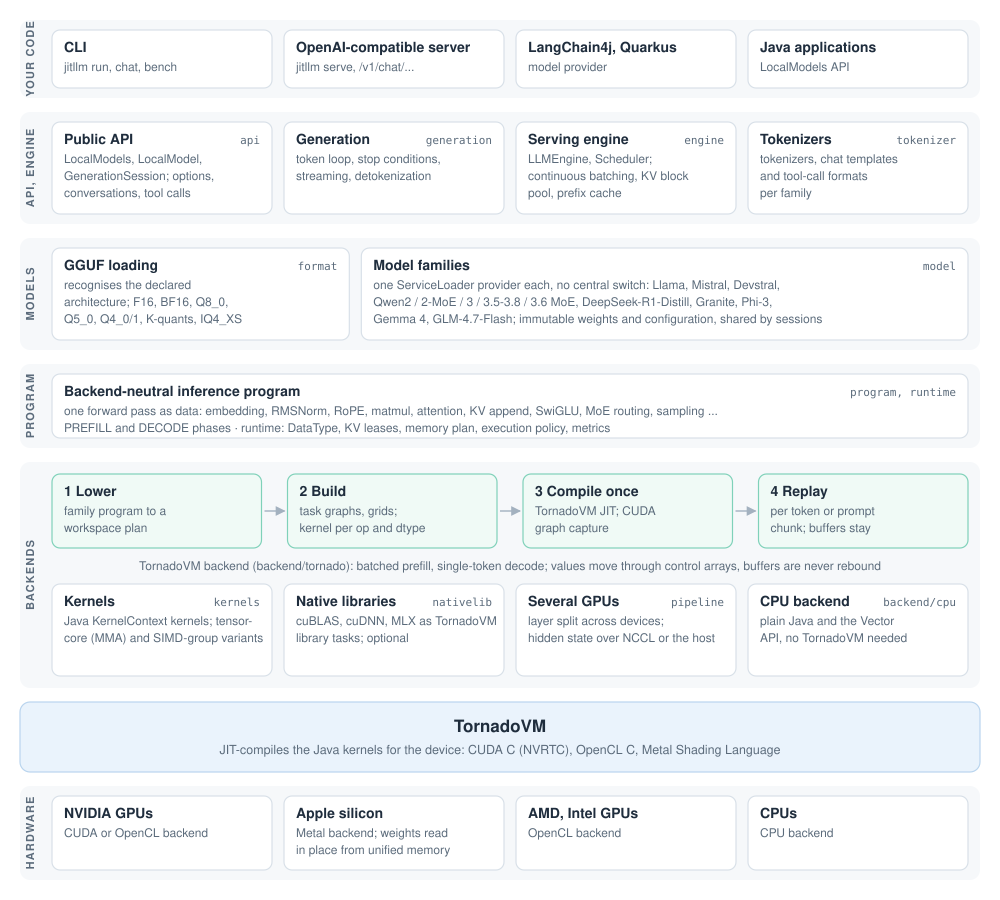

# jitLLM: LLM inference & serving for the JVM, on any GPU

[](https://github.com/beehive-lab/jitllm/actions/workflows/build-and-run.yml)
[](https://central.sonatype.com/artifact/io.github.beehive-lab/jitllm)


[](https://docs.langchain4j.dev/integrations/language-models/jitllm)


[](https://deepwiki.com/beehive-lab/jitllm)
[](LICENSE)

-----------

<table style="border: none;">
<tr style="border: none;">
<td style="width: 40%; vertical-align: middle; border: none;">

</td>
<td style="vertical-align: middle; padding-left: 20px; border: none;">

### Think vLLM — but pure Java, and it runs on **any** GPU.

**jitLLM** is a JVM-native LLM inference and serving engine. You write and ship plain Java; [**TornadoVM**](https://github.com/beehive-lab/TornadoVM) JIT-compiles the hot transformer kernels to **CUDA, OpenCL, or Apple Metal** at runtime — no JNI glue, no second toolchain, no native rebuild per GPU.

One `.jar` runs the same model on **NVIDIA, Intel, AMD, and Apple Silicon**, from a laptop to an RTX 5090.

Serve it behind an **OpenAI-compatible API**, embed it in **LangChain4j** or **Quarkus**, or run it from the CLI in one line.

</td>
</tr>
</table>


-----------

## Why jitLLM

- 🚀 **High performance.** Prompt processing on par with llama.cpp, from 1B models on a laptop GPU to 70B models split across several: tensor-core and SIMD-group kernels, CUDA graphs, and weights kept in their quantized form on the device.
- 🟦 **Pure Java, all the way down.** Transformer kernels are written in Java and accelerated by TornadoVM — no CUDA C, no hand-written JNI. Debug and build with the toolchain you already have.
- 🌍 **Write once, run on any GPU.** NVIDIA (CUDA), Intel & AMD (OpenCL), Apple Silicon (Metal). Backend is auto-detected from your TornadoVM SDK — switch with a flag, not a rebuild.
- 🔌 **Drop-in for the Java AI stack.** Official [LangChain4j](https://docs.langchain4j.dev/integrations/language-models/jitllm) model provider and [Quarkus LangChain4j](https://docs.quarkiverse.io/quarkus-langchain4j/dev/jitllm-chat-model.html) inference engine.
- ⚡ **Built to serve.** OpenAI-compatible HTTP server (`jitllm serve`) with streaming, batched prefill on tensor cores (CUDA) and SIMD-group matrices (Metal), CUDA graphs, and models split across several GPUs.
- 🧩 **Vendor libraries where they pay off.** cuBLAS and cuDNN on NVIDIA and MLX on Apple silicon run as TornadoVM library tasks inside the same execution plan, and NCCL moves data between GPUs; without them jitllm uses its own kernels.
- 📦 **Many models, one runtime.** Qwen 3 to 3.8 (dense and MoE), Gemma 4, GLM-4.7 / 5.3-Flash, Kimi Linear, LFM2 / LFM2.5, Devstral, Granite, Llama 3, Mistral, Phi-3, DeepSeek-R1-Distill and more, from F16 down to 4-bit GGUF. See [Models](#models).

-----------

## Quickstart

Every option needs a GGUF model ([Models](#models)) and a GPU with its vendor driver installed.

### 1. JBang

One command with [JBang](https://www.jbang.dev/): it fetches jitllm and TornadoVM from Maven Central. Needs
JDK 22 or newer; no TornadoVM SDK.

```bash
jbang jitllm@beehive-lab -m model.gguf -p "Explain GPU acceleration in one sentence."
jbang app install jitllm@beehive-lab && jitllm -m model.gguf -p "Hello!"   # as a command
```

It runs on CUDA, or Metal on Apple silicon; `--opencl` (or `--cuda`, `--metal`) picks another backend.

### 2. Maven Central only

No TornadoVM SDK: jitllm, TornadoVM's runtime and the driver for your GPU are ordinary jars.

```xml
<dependency>
    <groupId>io.github.beehive-lab</groupId>
    <artifactId>jitllm</artifactId>
    <version>3.1.0-jdk22plus</version>
</dependency>
<dependency>
    <groupId>io.github.beehive-lab</groupId>
    <artifactId>tornado-runtime</artifactId>
    <version>8.2.0-jdk22plus</version>
</dependency>
<dependency>
    <groupId>io.github.beehive-lab</groupId>
    <artifactId>tornado-drivers-cuda</artifactId>   <!-- or tornado-drivers-metal, tornado-drivers-opencl -->
    <version>8.2.0-jdk22plus</version>
</dependency>
```

Call the [Java API](#java), or run the CLI from those jars (`mvn dependency:copy-dependencies -DoutputDirectory=lib`
collects them):

```bash
java --enable-native-access=ALL-UNNAMED --add-modules jdk.incubator.vector -cp "lib/*" \
  org.beehive.jitllm.JitllmApp --gpu -m model.gguf -p "Explain GPU acceleration in one sentence."
```

On JDK 21 use the `-jdk21` versions and add `--enable-preview`. Add `tornado-cublas` and
`tornado-cudnn` (NVIDIA) or `tornado-mlx` (Apple silicon) for the native-library prefill.

### 3. TornadoVM SDK

The SDK adds the `tornado` tools and is what the `jitllm` launcher and a source build use.

```bash
sdk install tornadovm               # SDKMAN!; or download from tornadovm.org
tornado --devices                   # your GPU should be listed
export TORNADOVM_HOME=~/.sdkman/candidates/tornadovm/current
```

Then run `jitllm` from a [source build](#building-from-source).

## Architecture

<p align="center">
  
</p>

A GGUF file is recognised by the model family that claims it and loaded into an immutable model shared
by any number of sessions. Each family describes its forward pass as a backend-neutral program. The
TornadoVM backend lowers that program once into task graphs, compiles them (and, on CUDA, captures
them as CUDA graphs), then replays them for every prompt chunk and every token, moving only small
control values. Prefill runs in batches on tensor-core or SIMD-group kernels, or on cuBLAS, cuDNN and
MLX where they are installed; decode runs one token at a time. [docs/architecture](docs/architecture/README.md)
covers the layers, execution, memory and how to add a model family.

## Models

Ready-to-run GGUF files: **[beehive-lab on Hugging Face](https://huggingface.co/beehive-lab)**. Files from
other publishers (unsloth, bartowski, the model vendors) work too.

| Model | Sizes | Quantizations | Tools |
|---|---|---|---|
| GLM-5.3-Flash ¹ |  | Q8_0 (Q4_0 experts) | no |
| Qwen 3.8 | 27B | Q8_0, Q4_0 | yes |
| Qwen 3.6 MoE | 35B-A3B | Q8_0 | yes |
| Gemma 4 | E2B, 31B | BF16, Q8_0, Q4_0, Q4_K_M | yes |
| LFM2.5 MoE ² | 24B-A2B | Q8_0, Q4_K (UD-Q4_K_XL) | yes |
| Qwen 3.5 | 0.8B, 4B | F16, Q8_0, Q4_0, Q4_K_M | yes |
| GLM-4.7-Flash | 30B-A3B | Q8_0 | no |
| Devstral Small 2 | 24B (2512) | Q8_0, Q4_K_M | no |

<details>
<summary>Older models (13 more)</summary>

| Model | Sizes | Quantizations | Tools |
|---|---|---|---|
| Kimi Linear ¹ | 48B-A3B | Q8_0 (Q4_0 experts) | no |
| LFM2 MoE ² | 8B-A1B | Q8_0, Q4_K (UD-Q4_K_XL) | yes |
| Granite 4.0 | 1B | F16, Q8_0 | yes |
| Qwen 3 | 0.6B, 1.7B, 4B, 8B | F16, Q8_0, Q6_K, Q5_K, Q4_K, Q4_1, Q4_0 | yes |
| Granite 3.2 | 2B | F16, Q8_0, Q4_K_M | yes |
| DeepSeek-R1-Distill-Qwen | 1.5B, 7B | F16, Q8_0 | no |
| Llama 3.3 | 70B | Q4_0 | yes |
| Llama 3.2 | 1B, 3B | F16, Q8_0, Q6_K, Q5_K_M, Q4_K, Q4_1, Q4_0 | yes |
| Qwen 2.5 | 0.5B, 1.5B | F16, Q8_0, Q4_K_M | yes |
| Llama 3.1 | 8B | F16, Q8_0 | yes |
| Mistral v0.3 | 7B | F16, Q8_0, Q4_K_M | no |
| Phi-3 | mini-4k | F16, Q8_0, Q4_K_M | no |
| Qwen 1.5 MoE | A2.7B | Q8_0, Q6_K, Q4_0 | no |

</details>

Sizes and quantizations are the files the tests and CI run; other sizes and GGUF
types of a family load too, and a type its kernels do not read is converted to Q8_0 at load.
Instruct or chat variants throughout.\
¹ CPU and CUDA only; Q8_0 projections. GLM-5.3-Flash runs split across several GPUs.\
² One GPU; batched prefill on CUDA and Metal.

Per-backend support and multi-GPU splits: [models-and-backends.md](docs/architecture/models-and-backends.md),
[multi-gpu.md](docs/architecture/multi-gpu.md).

## Using it

### CLI

```bash
./jitllm run   -m model.gguf --gpu --prompt "Explain SIMD."     # one response
./jitllm chat  -m model.gguf --gpu                              # terminal conversation
./jitllm serve -m model.gguf --gpu --port 8080                  # OpenAI-compatible API on 127.0.0.1
./jitllm bench -m model.gguf --gpu --pp 512 --tg 128            # llama-bench-style pp/tg table
```

The backend (CUDA, OpenCL, HIP or Metal) comes from the SDK in `TORNADOVM_HOME`; `--cuda`, `--opencl`,
`--hip` or `--metal` picks one from an SDK built with several. On HIP (AMD GPUs) TornadoVM compiles
kernels with hipRTC, so `ROCM_PATH` must name a ROCm 7 install, and the KV cache is FP32
(`--fp32-kv-cache`), as on OpenCL on a non-NVIDIA GPU. `-v` prints the run configuration, memory plan and
startup timings. `./jitllm COMMAND --help` lists every option.

<p align="center"></p>

`jitllm serve` exposes `/v1/chat/completions`, `/v1/completions` and `/v1/models`, with streaming.
`--continuous-batching N` (experimental) decodes up to N requests together.

### Java

<!-- DEPENDENCY-SNIPPETS:START -->
**JDK 21** (`jdk21` profile, auto-activates for JDK `[21,22)`):
```xml
<dependency>
    <groupId>io.github.beehive-lab</groupId>
    <artifactId>jitllm</artifactId>
    <version>3.1.0-jdk21</version>
</dependency>
```

**JDK 22+** (`jdk22plus` profile, auto-activates for JDK `[22,)`):
```xml
<dependency>
    <groupId>io.github.beehive-lab</groupId>
    <artifactId>jitllm</artifactId>
    <version>3.1.0-jdk22plus</version>
</dependency>
```

### 📦 Gradle

**JDK 21**:
```groovy
implementation 'io.github.beehive-lab:jitllm:3.1.0-jdk21'
```

**JDK 22+**:
```groovy
implementation 'io.github.beehive-lab:jitllm:3.1.0-jdk22plus'
```
<!-- DEPENDENCY-SNIPPETS:END -->

```java
try (LocalModel model = LocalModels.load(path, ModelOptions.defaults())) {
    TextGenerationModel text = (TextGenerationModel) model;
    try (GenerationSession session = text.newSession()) {
        session.generate(GenerationRequest.builder()
                .prompt("What is the capital of France?")
                .maxNewTokens(64)
                .onEvent(e -> System.out.print(e.text()))
                .build());
    }
}
```

TornadoVM is not bundled. Either add `tornado-runtime` and a `tornado-drivers-*` jar from Maven Central
([Quickstart](#2-maven-central-only)), or start the JVM with `@$TORNADOVM_HOME/tornado-argfile --add-modules jdk.incubator.vector`.
The API, options, conversations and tool calls are in [api.md](docs/architecture/api.md).

### LangChain4j and Quarkus

jitllm is a model provider in [LangChain4j](https://docs.langchain4j.dev/integrations/language-models/jitllm) (`JitLLMChatModel`,
`JitLLMStreamingChatModel`) and an inference engine in
[Quarkus LangChain4j](https://docs.quarkiverse.io/quarkus-langchain4j/dev/jitllm-chat-model.html).

```java
JitLLMChatModel model = JitLLMChatModel.builder()
        .modelPath(modelPath)
        .temperature(0.7)
        .maxTokens(2048)
        .onGPU(true)
        .build();
```

## Large models and several GPUs

The default device budget is 14 GB; raise it with `--gpu-memory 20GB`. A load that runs out fails with
`GPUL-MEM-001` and prints the predicted memory plan.

A model too large for one GPU splits by layers across several:

```bash
./jitllm run --gpu --cuda --devices 0:0,0:1 --tensor-split 41,39 --gpu-memory 21GB \
  -m Llama-3.3-70B-Instruct-Q4_0.gguf -c 2048 --prompt "Why is the sky blue?"
```

Supported families, `--split-transport nccl|host` and how the pipeline works:
[multi-gpu.md](docs/architecture/multi-gpu.md).

## Building from source

Needs JDK 21 or 22+ and a TornadoVM SDK (8.1+) of the same JDK line in `TORNADOVM_HOME`.

```bash
git clone https://github.com/beehive-lab/jitllm.git && cd jitllm
export TORNADOVM_HOME=~/.sdkman/candidates/tornadovm/current
./mvnw clean package -DskipTests
./jitllm run --gpu -m model.gguf --prompt "Hello"
```

IDE setup, building against TornadoVM `develop`, GraalVM native image and releases:
[development.md](docs/architecture/development.md) and [native-image.md](docs/native-image.md).

## Documentation

| | |
|---|---|
| [docs/architecture](docs/architecture/README.md) | layers, execution, memory and concurrency, model families, multi-GPU, verification |
| [CHANGELOG.md](CHANGELOG.md) | release notes |
| [CONTRIBUTING.md](CONTRIBUTING.md) | building, testing and submitting a change |

## Acknowledgments

Partially funded by EU Horizon Europe and UKRI grants: [AERO 101092850](https://aero-project.eu/),
[P2CODE 101093069](https://p2code-project.eu/), [ENCRYPT 101070670](https://encrypt-project.eu),
[TANGO 101070052](https://tango-project.eu).

If you use jitllm in research, please cite it ([CITATION.cff](CITATION.cff)).

## License

[Apache License 2.0](LICENSE)
